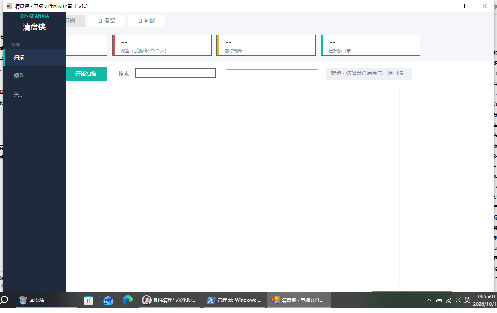

# 清盘侠（qingpanxia）· PC 文件审计与清理决策技能

> 让 AI 助手帮你把电脑上每个文件夹/文件"是什么、多大、能不能删"讲清楚，你逐项拍板，安全清理。**个人免费 · 商用需授权 · 社区共建**

[](LICENSE)


---



## 🎯 这是什么

一个给 AI 助手（Claude/豆包/Cursor 等支持 Skill 的 Agent）用的**电脑文件审计技能**。它让 AI 能够：

1. **扫描**你的整个磁盘（只读，不碰任何文件）
2. **识别**每个文件夹/文件是干什么的（软件/系统/个人数据/缓存/残留）
3. **三档分类**：🔴必须保留 / 🟢明确可删 / 🟡你判断
4. **你逐项决策**（"1-10删""这些都保留"），AI 按你的点名安全清理
5. **记住你的决策**（decisions.md），同类文件下次自动按你的习惯处理
6. **自我迭代**：每次使用把新坑/新经验写回经验库，越用越准

## 🚀 快速开始

### 方式一：装进 AI 助手（推荐）

把本仓库 `qingpanxia/` 文件夹复制到你电脑的 Skill 目录：

```
Windows:  %USERPROFILE%\.doubao\agent_mode\workspace\.user_skills\qingpanxia
Claude:   ~/.claude/skills/qingpanxia
```

然后对 AI 说：

> "分析一下我 C 盘上都有什么文件，哪些能删"
> "看下 D 盘这些文件夹是干什么的，还需要吗"
> "帮我生成一份文件清理判断清单"

### 方式二：手动使用

不装 Skill 也能用脚本：

```powershell
# 1. 扫描 D 盘目录占用（只读）
powershell -ExecutionPolicy Bypass -File scripts/scan_dirs.ps1 -Drive D

# 2. 对照 references/dir-guide.md 判断每个目录功能
```

### 方式三：AI 直连（MCP Server）——所有支持 MCP 的 AI 都能调用

> MCP（Model Context Protocol）是 AI 行业标准接口。**只要客户端支持 MCP（Claude / Cursor / Gemini CLI / Qwen Code / Codex / Cherry Studio / ChatWise 等），配置好下面这段就能直接调用扫描/分类/删除能力**——AI 会像人一样自己操作这台电脑的文件审计。

**通用配置片段**（任何 MCP 客户端都适用，把 `<路径>` 换成脚本实际位置）：

```json
{
  "mcpServers": {
    "qingpanxia": {
      "command": "powershell",
      "args": ["-NoProfile", "-ExecutionPolicy", "Bypass", "-File", "D:\\path\\to\\qingpanxia\\scripts\\qingpanxia-mcp.ps1"]
    }
  }
}
```

**各客户端配置位置**：

| 客户端 | 怎么配 |
|---|---|
| **Claude Desktop** | 编辑 `%APPDATA%\Claude\claude_desktop_config.json`（MSIX 版在 `%LOCALAPPDATA%\Packages\Claude*\LocalCache\Roaming\Claude\`），粘贴上面片段，完全退出重启 |
| **Cursor** | 设置 → MCP → Add new MCP server → 类型 stdio，command 填 `powershell`，参数填上表 args |
| **Claude Code** | 终端执行 `claude mcp add --transport stdio qingpanxia -- powershell -NoProfile -ExecutionPolicy Bypass -File "<完整路径>"` |
| **Gemini CLI** | 编辑 `%USERPROFILE%\.gemini\settings.json`，加 `"mcpServers": {...}` 段 |
| **Qwen Code** | 编辑 `%USERPROFILE%\.qwen\settings.json`，加 `"mcpServers": {...}` 段 |
| **Codex CLI** | 编辑 `%USERPROFILE%\.codex\config.toml`，加 `[mcp_servers.qingpanxia] command="powershell" args=[...]` |
| **Cherry Studio / ChatWise / AnythingLLM 等** | 设置 → MCP → 添加本地服务器：command `powershell`，args 同上 |

**⚠️ 安全提醒**：MCP 让 AI 获得操作电脑的能力，务必用可信的 AI 客户端、只配本机 localhost；本项目的删除护栏默认强制（只读扫描、删除需 `confirm=YES`、只进回收站+变更收据），与 Windows-MCP 默认全开相反，安装即安全。

## 🧠 工作原理

```
扫描(只读) → 目录功能识别 → 三档分类 → 用户逐项决策 → 安全删除 → 汇报+记录
                            ↓                    ↓
                  深度扫描检查清单(8项)     decisions.md 决策记忆
```

**安全原则**：
- 只报告不越权：删除前必须用户点名
- 宁可漏删，不可误删个人文件
- L3 黑名单永远不做：停杀毒服务 / 动 System32 / 删个人目录 / bcdedit 写操作
- 默认进回收站（回收站被禁用的机器自动降级为"清单确认+永久删"）

## 🤖 MCP Server（让任意 AI 客户端直接调用扫描/删除能力）

> 借鉴 [CursorTouch/Windows-MCP](https://github.com/CursorTouch/Windows-MCP)（MIT）"能力即工具"思想原创实现，**PowerShell 原生、零依赖**——客户机无需 Python/uv/任何库，只需 Windows 自带 PowerShell 5.1。安全护栏与 GUI 一致：只读默认、删除需 `confirm=YES`、只进回收站、写变更收据。

**启动**：
```powershell
powershell -NoProfile -ExecutionPolicy Bypass -File qingpanxia-mcp.ps1
```

**在 Claude Desktop 注册**（`claude_desktop_config.json`）：
```json
{
  "mcpServers": {
    "qingpanxia": {
      "command": "powershell",
      "args": ["-NoProfile", "-ExecutionPolicy", "Bypass", "-File", "D:\\path\\to\\qingpanxia-mcp.ps1"]
    }
  }
}
```

**7 个工具**：`scan_disk`（全盘扫描+分类）/ `dir_size`（目录占用）/ `get_category`（三档判断）/ `search_files`（大文件搜索）/ `list_rules`（规则清单）/ `delete_to_recycle`（安全删除，需 confirm）/ `change_history`（变更收据）。

**安全护栏（默认强制）**：扫描/查询全只读；删除必须传 `confirm=YES`；删除进回收站 + 写 `ChangeHistory.txt`；不开放 PowerShell/Registry 等全系统高危工具。

**手动自测**（管道方式，服务器逐行响应）：
```powershell
'{"jsonrpc":"2.0","id":1,"method":"initialize","params":{}}' | powershell -NoProfile -ExecutionPolicy Bypass -File qingpanxia-mcp.ps1
```

## 📦 目录结构

```
qingpanxia/
├── SKILL.md                  # 技能主文件（给 AI 读）
├── references/
│   ├── dir-guide.md          # Windows 常见目录功能对照表
│   ├── fixes.md              # 实战修复案例（服务/回收站/残留）
│   ├── experience-log.md     # 经验库（自我迭代载体）
│   └── decisions.md          # 用户决策记忆模板
├── scripts/
│   ├── scan_dirs.ps1         # 目录占用扫描脚本（只读）
│   ├── qingpanxia-gui.ps1 # 可视化窗口 GUI（零依赖）
│   ├── qingpanxia-mcp.ps1 # MCP Server（零依赖）
│   └── mcp_*_test.ps1        # MCP 全协议回归测试脚本
```

## 🤝 社区共建（收集所有人的优势）

这个项目的核心设计是**众人拾柴**：每个人的电脑都是不同的"标本"，遇到的坑、发现的残留类型、验证过的删除规则，都能让这个技能更聪明。

**你可以贡献**：

| 贡献类型 | 怎么做 |
|---|---|
| 🐛 报告新坑/新报错 | 开 Issue（选"新坑报告"模板） |
| 🗂️ 补充目录对照 | 你电脑上有个 dir-guide 没覆盖的目录 → 提 PR 加到 `references/dir-guide.md` |
| 🧹 新残留类型 | 发现一种新的卸载残留模式 → 提 PR 更新 `SKILL.md` 深度扫描清单 |
| ⚡ 脚本优化 | 更快/更稳的扫描脚本 → 提 PR 到 `scripts/` |
| 🌍 其他平台 | macOS/Linux 的目录对照 → 新增 `references/dir-guide-macos.md` |
| 📝 文档改进 | README/模板任何改进 |

**贡献流程**：`Fork → 改 → PR → 审核合并`，详见 [CONTRIBUTING.md](CONTRIBUTING.md)。所有经验条目自动进入 `experience-log.md`，沉淀进技能。

## 📜 开源协议

[qingpanxia 自定义许可协议](LICENSE)：

- **个人使用完全免费**（自用、学习、修改都行）
- **商用需作者（hulufeng）书面授权**——包括公司内部使用、对外服务、集成到商业产品、销售分发等
- 详细条款见 [LICENSE](LICENSE)，商业合作可通过 GitHub Issues 联系

## 🗓️ 版本历史

见 [CHANGELOG.md](CHANGELOG.md)。

---

> 💡 **灵感来源**：本项目由"联想 G505 老电脑全盘清理实战"蒸馏而来，实战清出 26GB+ 空间。GitHub 开源工具调研（WinDirStat/WizTree/Czkawka/CleanOS 等）的思路已融入深度扫描检查清单。
